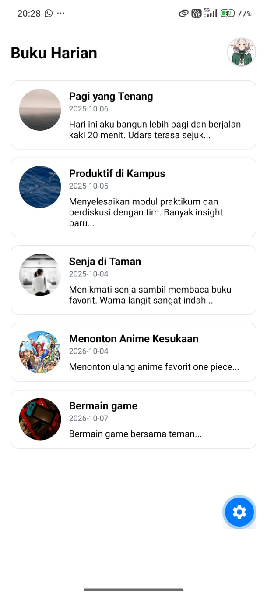
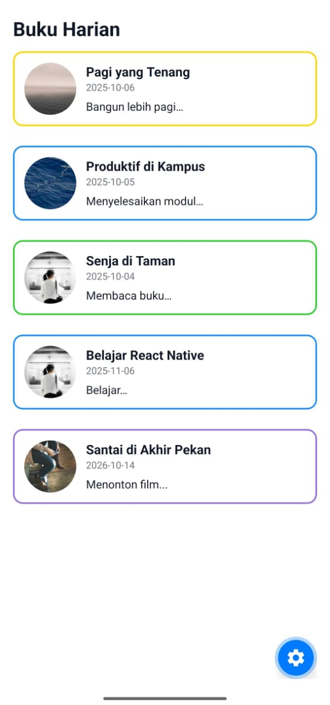
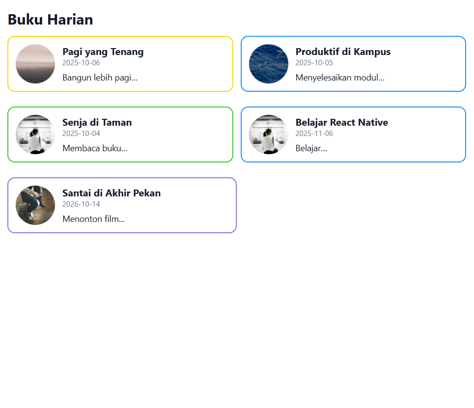

# 📔 Diary App

Aplikasi *mobile* untuk mencatat dan melihat kembali momen-momen berharga dalam bentuk buku harian digital, dibangun menggunakan React Native dan Expo CLI[cite: 1]. 

## 👤 Informasi Mahasiswa

*   **Nama**: Naufal Alexander
*   **NIM**: 2430511010
*   **Mata Kuliah**: Pemrograman Mobile Multiplatform
*   **Studi Kasus**: Diary App - Responsive Layout Flexbox & Stylesheet

## 📱 Bukti Tampilan Aplikasi
Versi sebelumnya:


Aplikasi telah diperbarui untuk mendukung *layout* responsif:

**Tampilan Ponsel (1 Kolom)**


**Tampilan Tablet/Web (2 Kolom)**


## ✨ Fitur yang Diselesaikan

### Versi Sebelumnya (Praktikum Pertemuan 2)
*   Membuat struktur proyek *mobile* berbasis React Native dan Expo.
*   Menggunakan komponen antarmuka statis dasar (`View`, `Text`, `Image`) dan `StyleSheet`[cite: 2].
*   Mengonfigurasi penanganan *safe area* menggunakan `react-native-safe-area-context`[cite: 2].

### Pembaruan Saat Ini (Praktikum Pertemuan 3)
*   **Flexbox**: Menerapkan Flexbox untuk mengatur arah, *alignment*, spasi, dan ukuran elemen pada antarmuka[cite: 2].
*   **Design Tokens**: Menyusun *StyleSheet* yang rapi dan terpusat dengan *design tokens* untuk warna, spasi, radius, tipografi, dan *breakpoint*[cite: 2, 5].
*   **Layout Responsif**: Membuat tata letak yang beradaptasi otomatis menjadi daftar 1 kolom pada ponsel dan 2 kolom pada lebar layar >= 600 piksel menggunakan komponen `useWindowDimensions`[cite: 2, 3, 16].
*   **FlatList**: Menggunakan komponen `FlatList` untuk menampilkan data entri secara efisien[cite: 2].
*   **Reusable Component**: Mengoptimalkan komponen `DiaryCard` yang interaktif menggunakan `Pressable` agar dapat beroperasi pada mode *list* maupun *grid*[cite: 2, 3].
*   **Modal Detail**: Mengintegrasikan `DiaryDetailModal` untuk menampilkan isi lengkap catatan dan *hero image* tanpa berpindah layar ketika `DiaryCard` ditekan[cite: 2, 3].
*   **Aksesibilitas**: Mengimplementasikan prinsip aksesibilitas dasar melalui penggunaan `accessibilityLabel`, target sentuh yang memadai, dan tingkat kontras[cite: 2, 16].
*   **Dynamic Mood Border (Tantangan)**: Menerapkan gaya *border* dengan warna yang berbeda menyesuaikan setiap tipe *mood* (suasana hati) pengguna[cite: 16].

## 🚀 Cara Menjalankan Project

1.  Buka terminal dan pastikan Anda berada di direktori proyek `diary-app`.
2.  Unduh seluruh dependensi proyek:
    ```bash
    npm install
    ```
3.  Jalankan server *development*:
    ```bash
    npx expo start
    ```
    *(Tunggu hingga muncul kode QR di terminal)*[cite: 5].
4.  Gunakan **Expo Go** di ponsel Anda untuk memindai kode QR, atau tekan tombol `a` di terminal untuk menjalankan aplikasi pada Android Emulator[cite: 5, 14].